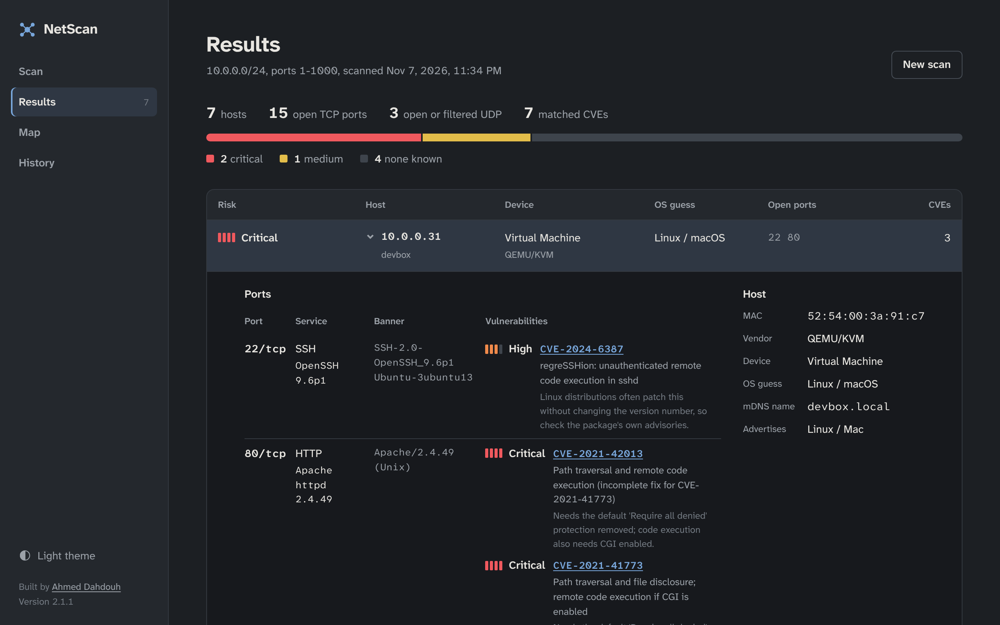
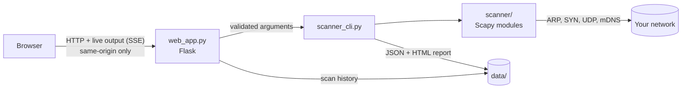

# NetScan

Network discovery, port scanning and CVE lookup with a web dashboard, written
from scratch in Python and Scapy to learn how tools like Nmap work at the
packet level. Then hardened on the assumption that the devices it scans may be
hostile, because a scanner's own targets get to write the data it displays.

[](https://github.com/AhmedDAH1/network-scanner/actions/workflows/tests.yml)
[](https://github.com/AhmedDAH1/network-scanner/releases/latest)
[](https://network-scanner-8ihy.onrender.com)


[](LICENSE)

**[Open the live demo](https://network-scanner-8ihy.onrender.com)**: a read-only
dashboard showing a sample scan of a fictional home lab. Real scans need raw
sockets, which the free host doesn't allow, so run it locally to scan your own
network.



## What it does

- **Host discovery:** ARP sweep with an ICMP fallback. Picks the active
  interface on its own and skips VPN tunnels.
- **Port scanning:** TCP SYN (half-open) scan, plus an optional UDP scan of
  common ports.
- **Identification:** service banners, MAC vendor lookup (offline),
  randomized-MAC detection, mDNS/Bonjour names and services, and an OS guess
  from the packet TTL.
- **Vulnerabilities:** CVEs matched by the product and version each service
  reports (web servers are asked for their `Server` header), from a verified
  offline list and exact-version NVD lookups. No version, no CVE claim.
- **Output:** terminal tables, JSON, and a self-contained HTML report you can
  email or print.
- **Web dashboard:** live scan output, findings sorted by risk, a network map,
  scan history, and light and dark themes.
- **Detections for itself:** Suricata and Sigma rules that catch NetScan's own
  scans, tested against recorded traffic in CI ([below](#detecting-netscan)).

## Quick start

### Docker

```bash
git clone https://github.com/AhmedDAH1/network-scanner.git
cd network-scanner
docker compose up
```

Then open http://localhost:8000. The container gets only the `NET_RAW` and
`NET_ADMIN` capabilities it needs (never `--privileged`), the dashboard is
published on your machine's loopback only, and scan history is kept in `./data`.

> **Scanning your real LAN from Docker:** Docker Desktop on macOS and Windows
> runs containers inside a virtual machine, so host discovery sees that VM's
> network instead of your Wi-Fi. Run NetScan locally (below) to scan your LAN.
> On Linux, use host networking:
> `docker compose -f docker-compose.yml -f docker-compose.host.yml up`

### Local (Python 3.10+)

```bash
git clone https://github.com/AhmedDAH1/network-scanner.git
cd network-scanner
pip install -r requirements.txt

sudo python3 web_app.py                          # dashboard on http://localhost:8000
sudo python3 scanner_cli.py -n 192.168.1.0/24    # or scan from the terminal
```

Raw packets need root, hence `sudo`. Files created during a `sudo` run are
handed back to your user, so later runs without `sudo` still work.
`pip install -e .` also installs `netscan` and `netscan-web` commands.

To see exactly what the live demo shows: `DEMO_MODE=1 python3 web_app.py`.

## Command line

```bash
sudo python3 scanner_cli.py -n 192.168.1.0/24              # whole network, ports 1-1000
sudo python3 scanner_cli.py -t 192.168.1.1 -p 1-65535      # one host, every port
sudo python3 scanner_cli.py -n 192.168.1.0/24 --udp --vuln # add UDP and CVE lookup
sudo python3 scanner_cli.py -t 192.168.1.1 --vuln --no-api # CVE lookup without internet
```

| Option | Description |
|---|---|
| `-n`, `--network` | Network to scan, in CIDR notation (`192.168.1.0/24`) |
| `-t`, `--target` | A single host |
| `-p`, `--ports` | Port range (default `1-1000`) |
| `--udp` | Also scan common UDP ports |
| `--vuln` | Look up known CVEs for each service (NVD API) |
| `--no-api` | With `--vuln`: use the offline CVE table only |
| `--version` | Show the version |

Each scan writes `scan_results.json` and `scan_report.html`.

## Security design

A scanner is an unusual web application: it runs as root, and the data it
shows is written by the devices it scans. NetScan treats four sources as
potentially hostile.

| Threat | Example | Defence |
|---|---|---|
| **A scanned device** | A service answers with ``, or with terminal escape codes, as its banner | Every value is HTML-escaped. A strict Content-Security-Policy (no inline scripts, handlers or styles) blocks injected code even if escaping were missed. The report embeds data so a `</script>` in a banner can't end the script block. Banners are reduced to printable characters, so escape codes can't rewrite your terminal. |
| **A website you visit** | `` starts a root scan | Scans can only be started from the dashboard's own page (`Sec-Fetch-Site` and `Origin` checks against CSRF), and the `Host` header must be `localhost` or `127.0.0.1` (DNS rebinding). |
| **Others on your network** | Someone on the same Wi-Fi opens your dashboard | It listens on `127.0.0.1` only. Docker publishes it on the host's loopback only. |
| **Input to a root process** | `10.0.0.1; rm -rf ~`, or a target of `-p` | Input is parsed with `ipaddress` and the command is rebuilt from the parsed values; there is no shell. Helper binaries run from absolute paths, never through `PATH`. |

Each defence has tests that fail if it's removed. The
[2.0.0 changelog](CHANGELOG.md#200---2026-11-07) lists the vulnerabilities and
bugs that were found and fixed.

## Detecting NetScan

Building a scanner is half the picture; the other half is catching one.
[`detections/`](detections/) has rules that detect this scanner from the
defender's side, at three levels of the Pyramid of Pain:

| Layer | Rule | Matches |
|---|---|---|
| Tool artifact | Suricata, Sigma (web server logs) | The `netscan/<version>` User-Agent of the HTTP probe |
| Network fingerprint | Suricata | Scapy's default SYN: source port 20, sequence 0, window 8192, no TCP options |
| Behaviour | Sigma correlation (Zeek `conn`) | 25+ ports rejected or unanswered on one host within a minute, from any tool |

Each rule fires on a real recorded NetScan scan and stays silent on a benign
capture built to trip it (active-mode FTP also sends SYNs from port 20). CI
runs Suricata on both captures, executes the Sigma rules and checks they still
convert to Splunk and Elasticsearch queries. Results, the rule variants that
were rejected and why, and the limitations are in
[detections/TESTING.md](detections/TESTING.md). Suricata's alerts can be sent
to [SOAR-Lite](https://github.com/AhmedDAH1/soar-lite), where they become
incidents with the scanner's address as an indicator
([detections/forward_alerts.py](detections/forward_alerts.py)). The Sigma rules are also in my
[Sigma rule collection](https://github.com/AhmedDAH1/sigma-detection-rules),
tested to the same standard as every other rule there.

## Testing

```bash
pip install -r requirements-dev.txt
python3 -m pytest      # 194 tests, about 9 seconds, no root or internet needed
ruff check .           # lint, including the Bandit security rules
```

The Suricata tests are skipped if Suricata isn't installed; CI installs it
and runs everything on every push. To check that the tests catch real problems, ten
bugs this project actually had were put back one at a time; each one failed a
test named after it.

## How it works



- **Host discovery** sends ARP requests on the active interface and falls back
  to ICMP echo if nothing answers.
- **SYN scan** sends a SYN to each port. A SYN-ACK means open; the scanner
  replies with RST instead of completing the handshake.
- **UDP scan** treats an ICMP port-unreachable as closed and silence as open or
  filtered.
- **OS guess** reads the TTL of a ping reply (64 suggests Linux or macOS, 128
  Windows). It's a hint, not a fingerprint.
- **Device identification** combines the MAC vendor (offline OUI data),
  randomized-MAC detection and mDNS service announcements.
- **CVE matching** reads the product and version from each banner, then checks
  them against affected version ranges: a small offline list of well-known
  CVEs whose ranges were checked against public advisories, plus NVD looked up
  by the exact CPE name (for example
  `cpe:2.3:a:openbsd:openssh:7.4:p1`), never by keyword. Ports whose version
  can't be identified are reported as not checked.

## Limitations

- **CVE matching needs a version in the banner.** Many services hide it, and
  those ports aren't checked, so "no CVEs" doesn't mean "not vulnerable".
  Linux distributions often backport fixes without changing the version
  number, so a match means "check this", not "confirmed". Every CVE links to
  its NVD entry.
- The OS guess uses only the TTL.
- IPv4 only, and networks up to /16.
- The dashboard has no login: it's protected by being reachable only from your
  own machine. It uses Flask's development server.
- Scanning needs root (raw sockets).

## Project structure

```
network-scanner/
├── scanner_cli.py          Command-line scanner
├── web_app.py              Flask dashboard: routes, validation, security headers
├── report_template.html    Self-contained HTML report
├── templates/, static/     Dashboard page, styles, scripts, bundled fonts
├── scanner/
│   ├── host_discovery.py   ARP + ICMP discovery, interface detection
│   ├── syn_scan.py         TCP SYN scan
│   ├── udp_scan.py         UDP scan
│   ├── service_detection.py  Port-to-service names, banner grabbing
│   ├── os_fingerprint.py   TTL-based OS guess
│   ├── device_detection.py MAC vendor lookup, randomized-MAC detection
│   ├── mdns_probe.py       mDNS/Bonjour identification
│   ├── vuln_scan.py        CVE lookup (NVD API + offline table)
│   ├── fileutil.py         Atomic writes, sudo-safe file ownership
│   └── port_scanner.py     TCP connect scan (not yet used by the CLI)
├── detections/             Suricata and Sigma rules that detect NetScan, with test captures
├── tests/                  pytest suite
├── demo/sample_scan.json   Sample data for the live demo
├── Dockerfile, docker-compose.yml, docker-compose.host.yml
└── pyproject.toml, CHANGELOG.md, SECURITY.md
```

## Why I built this

I'm a software engineering student working toward SOC analyst and detection
engineering roles. I understood port scanning and ARP discovery in theory but
not the mechanics on the wire, so I built a scanner to learn raw packet
crafting, the ARP/ICMP fallback, TTL fingerprinting and the trade-offs between
SYN and full TCP connect scans. Hardening it taught me the other side: how a
security tool can itself be attacked through the data it collects.

## Ethical use

Only scan networks you own or have written permission to test. Unauthorized
scanning can be illegal, for example under the CFAA in the US or the Computer
Misuse Act in the UK. See [SECURITY.md](SECURITY.md).

## Changelog

See [CHANGELOG.md](CHANGELOG.md).

## Author

**Ahmed Dahdouh**, software engineering student focused on security

[GitHub](https://github.com/AhmedDAH1) · [LinkedIn](https://www.linkedin.com/in/ahmed-dahdouh)

## License

MIT, see [LICENSE](LICENSE).
