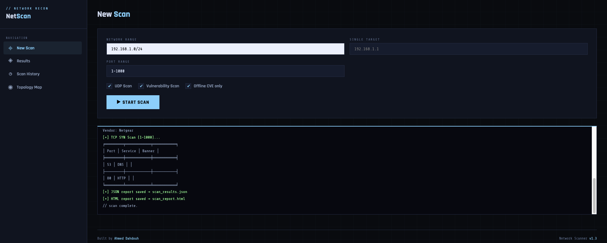

# 🔎 Network Scanner

> **🚀 [Live Demo →](https://network-scanner-8ihy.onrender.com)** &nbsp;·&nbsp; Try the dashboard with realistic sample scan data.
> *Live scanning is disabled in the deployed version (raw sockets aren't available on free-tier hosts). Clone and run locally with Docker to perform real scans — instructions below.*

[](https://network-scanner-8ihy.onrender.com)


A **multi-threaded network scanner** built in Python with SYN scanning, UDP scanning, OS detection, MAC vendor lookup, service detection, vulnerability scanning, and a full web dashboard with live scan streaming. Implemented from scratch to internalize how tools like Nmap work at the protocol level.



---

## Why I Built This

I'm a Software Engineering student specializing in cybersecurity, working toward a SOC analyst / detection engineer role. Reading about how port scanners craft raw packets and how ARP discovery actually works on the wire, I realized I understood the concepts in theory but not the mechanics. So I built one. The goal was to internalize raw socket programming, the ARP/ICMP fallback patterns, TTL-based OS fingerprinting, and the trade-offs between SYN scanning and full TCP connects — by writing the code, not just reading about it.

---

## 🚀 Features

| Feature | Status |
|---|---|
| Host Discovery (ARP + ICMP fallback) | ✅ |
| Auto Network Interface Detection (VPN-aware) | ✅ |
| TCP SYN Scan (multi-threaded) | ✅ |
| UDP Scan | ✅ |
| OS Fingerprinting (TTL-based) | ✅ |
| Service Detection + Banner Grabbing | ✅ |
| MAC Vendor Lookup (offline) | ✅ |
| Randomized MAC Detection | ✅ |
| Vulnerability Scan (NVD API + offline CVE table) | ✅ |
| mDNS Device Identification | ✅ |
| JSON + HTML Reports | ✅ |
| Web Dashboard (Flask + SSE streaming) | ✅ |
| Scan History | ✅ |
| Dark / Light Theme | ✅ |
| Docker + docker-compose | ✅ |
| Demo Mode for Portfolio Deployment | ✅ |

---

## Installation

### Option 1 — Docker (recommended)

```bash
git clone https://github.com/AhmedDAH1/network-scanner.git
cd network-scanner

# Launch the web dashboard with full scanning capability
docker compose up
```

Open http://localhost:8000 in your browser. The container is granted `CAP_NET_RAW` and `CAP_NET_ADMIN` capabilities (least-privilege; never `--privileged`) so Scapy can craft raw packets.

### Option 2 — Local Python

```bash
git clone https://github.com/AhmedDAH1/network-scanner.git
cd network-scanner
pip install -r requirements.txt

# Run the web dashboard
sudo python3 web_app.py

# Or run from the CLI
sudo python3 scanner_cli.py -n 192.168.1.0/24
```

> **Note:** SYN scanning and ARP host discovery require root privileges for raw socket access. Always run with `sudo`.

### Running the deployed demo locally

If you want to see exactly what the [live demo](https://network-scanner-8ihy.onrender.com) looks like:

```bash
DEMO_MODE=1 docker compose up
```

---

## 🌐 Web Dashboard

Start the web interface (see Installation above), then open **http://localhost:8000**.

The dashboard lets you:
- Run scans directly from the browser with a form UI
- Watch live terminal output stream in real time via Server-Sent Events
- View results with expandable host cards, port tables, and CVE listings
- Browse scan history — every scan is saved and reloadable
- Toggle between dark and light themes

---

## 🧠 CLI Usage

```bash
# Scan an entire network
sudo python3 scanner_cli.py -n 192.168.1.0/24

# Scan a single host
sudo python3 scanner_cli.py -t 192.168.1.1

# Scan a custom port range
sudo python3 scanner_cli.py -t 192.168.1.1 -p 1-65535

# Enable UDP scan
sudo python3 scanner_cli.py -t 192.168.1.1 --udp

# Enable vulnerability scan (NVD API)
sudo python3 scanner_cli.py -n 192.168.1.0/24 --vuln

# Vulnerability scan offline only
sudo python3 scanner_cli.py -n 192.168.1.0/24 --vuln --no-api

# Combine all options
sudo python3 scanner_cli.py -n 192.168.1.0/24 -p 1-500 --udp --vuln
```

---

## ⚙️ Command Line Options

| Option | Description |
|---|---|
| `-n` | Scan a network range (e.g. `192.168.1.0/24`) |
| `-t` | Scan a single host |
| `-p` | Port range (default: `1-1000`) |
| `--udp` | Enable UDP scan on common ports |
| `--vuln` | Enable CVE vulnerability scan (uses NVD API) |
| `--no-api` | Use offline CVE table only (no internet needed) |
| `-h` | Show help menu |

---

## 📸 Example Output

```
###########################################
#        NETWORK SCANNER v1.3            #
#        Author: Ahmed Dahdouh           #
###########################################

[+] Discovering hosts in 192.168.1.0/24
[+] Detected active interface: en0 (192.168.1.13)
[+] Running ARP Scan on interface en0...
[+] ARP scan found 3 host(s).
[+] mDNS probe (8s) — listening for device announcements...

─────────────────────────────────────────────
Scanning host: 192.168.1.1  [68:9a:21:2e:6a:a0]
─────────────────────────────────────────────
  OS:       Linux / macOS
  Device:   Router / AP
  Vendor:   Netgear

[+] TCP SYN Scan (1-1000)...
╒════════╤═══════════╤══════════╕
│   Port │ Service   │ Banner   │
╞════════╪═══════════╪══════════╡
│     53 │ DNS       │          │
├────────┼───────────┼──────────┤
│     80 │ HTTP      │          │
╘════════╧═══════════╧══════════╛

[+] Vulnerability scan — checking 2 port(s)...
    192.168.1.1:53 (DNS)  → 3 CVE(s), worst: CRITICAL
    192.168.1.1:80 (HTTP) → 3 CVE(s), worst: CRITICAL

[+] JSON report saved → scan_results.json
[+] HTML report saved → scan_report.html
```

---

## Skills Demonstrated

This project maps directly to core network security and detection engineering competencies:

| Skill | Where in this project |
|---|---|
| Raw socket programming | `scanner/syn_scan.py` — Scapy SYN packet crafting |
| Network discovery protocols | `scanner/host_discovery.py` — ARP + ICMP fallback, mDNS probe |
| Protocol-aware fingerprinting | `scanner/os_fingerprint.py` — TTL-based OS detection |
| Service identification | `scanner/service_detection.py` — banner grabbing + port mapping |
| External API integration with fallback | `scanner/vuln_scan.py` — NVD API + offline CVE table |
| MAC OUI lookup | `scanner/device_detection.py` — manuf library + curated table |
| Multi-threaded scanning | 100-thread concurrent SYN scanner |
| Real-time data streaming | Flask + Server-Sent Events for live scan output |
| Containerization with security constraints | Dockerfile with libpcap-dev, compose grants minimum capabilities (NET_RAW + NET_ADMIN) |
| Least-privilege design | No `--privileged`, no broader capabilities than needed |
| Cloud deployment with graceful degradation | Live demo runs in DEMO_MODE since raw sockets unavailable on free tiers |
| Defensive API design | Demo-mode endpoints return 403 to prevent abuse vectors |

---

## 📁 Project Structure

```
network-scanner/
│
├── scanner_cli.py           # CLI entry point
├── web_app.py               # Flask web dashboard
├── Dockerfile               # Production container with libpcap + tcpdump
├── docker-compose.yml       # Least-privilege capabilities (NET_RAW + NET_ADMIN)
├── report_template.html     # HTML report template
├── requirements.txt         # Pinned Python dependencies
├── SECURITY.md              # Security policy + ethical use clause
│
└── scanner/
    ├── host_discovery.py    # ARP + ICMP host discovery, interface detection
    ├── syn_scan.py          # TCP SYN scanning (multi-threaded)
    ├── udp_scan.py          # UDP scanning (multi-threaded)
    ├── service_detection.py # Port-to-service mapping + banner grabbing
    ├── os_fingerprint.py    # TTL-based OS fingerprinting
    ├── device_detection.py  # MAC vendor lookup + device classification
    ├── mdns_probe.py        # mDNS/Bonjour device identification
    ├── vuln_scan.py         # CVE lookup via NVD API + offline table
    └── port_scanner.py      # TCP connect scan (fallback)
```

---

## 📄 JSON Output Example

```json
[
  {
    "host": "192.168.1.1",
    "mac": "68:9a:21:2e:6a:a0",
    "vendor": "Netgear",
    "os": "Linux / macOS",
    "device": "Router / AP",
    "tcp_ports": [
      {
        "port": 53,
        "service": "DNS",
        "banner": null,
        "cves": [
          { "id": "CVE-2020-1350", "severity": "CRITICAL", "desc": "Windows DNS Server RCE (SIGRed)" }
        ]
      }
    ],
    "udp_ports": []
  }
]
```

---

## 🛠️ How It Works

**Host Discovery** — Sends ARP requests on the active network interface to find live hosts. Automatically detects the correct interface (skipping VPN tunnels). Falls back to ICMP ping if ARP fails.

**TCP SYN Scan** — Crafts raw SYN packets with Scapy and checks for SYN-ACK responses to identify open ports without completing the handshake. Runs with 100 concurrent threads.

**UDP Scan** — Sends UDP packets to common ports and interprets ICMP unreachable responses to determine closed vs. open/filtered status.

**OS Fingerprinting** — Analyses the TTL value in ICMP responses. TTL ≤ 64 → Linux/macOS, TTL ≤ 128 → Windows.

**MAC Vendor Lookup** — Uses a curated OUI table combined with the offline `manuf` library to identify device manufacturers without any internet dependency. Detects randomized/privacy MACs automatically.

**Service Detection** — Maps open ports to known service names and attempts banner grabbing to identify the exact software running.

**Vulnerability Scan** — Queries the NIST NVD API for CVEs matching each detected service. Falls back to a curated offline table covering FTP, SSH, HTTP, DNS, RDP, SMB, MySQL and more when offline. CVEs are rated CRITICAL / HIGH / MEDIUM / LOW using CVSS scores.

**Web Dashboard** — Flask server with Server-Sent Events (SSE) for real-time scan output streaming. Scan history is persisted locally as JSON.

---

## 🔮 Future Improvements

- CSV export
- Improved OS fingerprinting (TCP stack analysis)
- Version-aware CVE matching via banner grabbing
- IPv6 support
- Replace Flask dev server with gunicorn for production deployments

---

## 📌 Changelog

**v1.1.0** — Containerization, demo mode, and security hardening
- Production Dockerfile (Python 3.10-slim with libpcap-dev and tcpdump)
- docker-compose.yml grants minimum capabilities (NET_RAW + NET_ADMIN), never `--privileged`
- New `DEMO_MODE` env var for portfolio deployment
- Fixed broken scan command in web dashboard (`test.py` → `scanner_cli.py`)
- Added `SECURITY.md` with ethical-use clause and jurisdictional context
- API hardening: `/scan/stream` and `/scan/stop` return 403 in demo mode
- Live demo deployed at https://network-scanner-8ihy.onrender.com

**v1.3** — Web dashboard
- Added Flask web dashboard
- Live scan output streaming via Server-Sent Events
- Scan history with reloadable results
- Dark / light theme toggle

**v1.2** — Vulnerability scanning
- Added vulnerability scan (CVE lookup via NVD API + offline table)
- Added `--vuln` and `--no-api` CLI flags
- mDNS/Bonjour device identification

**v1.1** — UDP + vendor lookup
- Added UDP scanning
- Added MAC vendor lookup (offline, via manuf + curated OUI table)
- Added randomized MAC detection
- Fixed ARP scan on macOS (VPN-aware interface detection)

**v1.0** — Initial release
- Host discovery (ARP + ICMP)
- TCP SYN scanning
- OS fingerprinting
- Service detection
- HTML + JSON reporting

---

## 👨‍💻 Author

**Ahmed Dahdouh** — Software Engineering Student · Cybersecurity Enthusiast

[](https://github.com/AhmedDAH1)
[](https://www.linkedin.com/in/ahmed-dahdouh)

---

## ⚠️ Disclaimer

This tool is intended for **educational purposes only**. Only scan networks you own or have explicit written permission to test. Unauthorized network scanning may be illegal in your jurisdiction (CFAA in the US, Computer Misuse Act in the UK, Article 303a StGB in Germany, etc.). See [SECURITY.md](SECURITY.md) for the full ethical-use policy.

---

## 📜 License

MIT — see [LICENSE](LICENSE)
